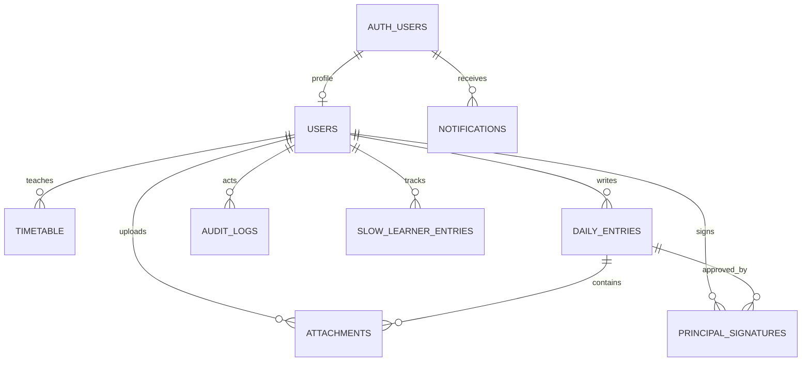

# Supabase schema

Derived from the application JavaScript and checked-in SQL migrations. This documents repository expectations, not a verified live database. No database changes are performed by this document.

## Scope and sources

- [all_migrations.sql](all_migrations.sql): core tables, workflow additions, notifications, curriculum lists, RLS, Storage, and the final single-school refactor.
- [slow_learner_migration.sql](slow_learner_migration.sql): remedial progress table, indexes, and timestamp trigger.
- [migration_add_delete_policy.sql](migration_add_delete_policy.sql): entry deletion policies and cascading signature deletion.
- [js/supabase.js](js/supabase.js), [js/auth.js](js/auth.js), [js/approval.js](js/approval.js), [js/history.js](js/history.js): application reads and writes.
- [js/api.js](js/api.js), [js/file-upload.js](js/file-upload.js), [js/notifications.js](js/notifications.js): REST content contracts, Storage, and notifications.

The final refactor removes `schools` and every core `school_id` column. School codes in `config/schools.v1.json` select a Supabase project through `js/boot.js`; the database schema itself does not separate schools. Deployments that require school isolation must use separate projects or supply a different tenancy design.

## Defined tables

The SQL below consolidates table definitions after the final refactor and separate migrations. It is a schema reference, not a complete executable provisioning script: policies, functions, grants, publications, and buckets are described separately. Columns are nullable unless explicitly `NOT NULL` or a primary key; a default does not imply non-nullability. Unspecified foreign-key delete actions use PostgreSQL's default `NO ACTION`.

### `public.users`

Application profiles linked to Supabase Auth. Roles: `teacher`, `principal`, `vice_principal`, `hod`, `admin`, `super_admin`. Profiles are upserted by the browser during sign-in; no signup trigger is defined in these migrations.

```sql
CREATE TABLE public.users (
  id UUID REFERENCES auth.users(id) PRIMARY KEY,
  email TEXT NOT NULL,
  name TEXT DEFAULT '',
  avatar_url TEXT DEFAULT '',
  role TEXT DEFAULT 'teacher' CHECK (role IN ('teacher', 'principal', 'vice_principal', 'hod', 'admin', 'super_admin')),
  created_at TIMESTAMPTZ DEFAULT now(),
  updated_at TIMESTAMPTZ DEFAULT now()
);
```

### `public.timetable`

One scheduled period per teacher and weekday. The database accepts weekdays 1–7.

```sql
CREATE TABLE public.timetable (
  id UUID DEFAULT gen_random_uuid() PRIMARY KEY,
  teacher_id UUID REFERENCES public.users(id) ON DELETE CASCADE,
  day_of_week INT NOT NULL CHECK (day_of_week BETWEEN 1 AND 7),
  period_number INT NOT NULL,
  class_section TEXT NOT NULL,
  subject TEXT NOT NULL,
  start_time TIME,
  end_time TIME,
  UNIQUE (teacher_id, day_of_week, period_number)
);
```

### `public.daily_entries`

One row per teacher, date, period, and revision. Allowed statuses: `draft`, `submitted`, `approved`, `revision_requested`. The app updates the latest draft in place and creates a new revision otherwise. This revision behavior is application logic, not a database trigger.

```sql
CREATE TABLE public.daily_entries (
  id UUID DEFAULT gen_random_uuid() PRIMARY KEY,
  teacher_id UUID REFERENCES public.users(id) ON DELETE CASCADE,
  date DATE NOT NULL,
  period_number INT NOT NULL,
  class_section TEXT DEFAULT '',
  subject TEXT DEFAULT '',
  classwork TEXT DEFAULT '',
  homework TEXT DEFAULT '',
  status TEXT DEFAULT 'draft' CHECK (status IN ('draft', 'submitted', 'approved', 'revision_requested')),
  revision_number INT DEFAULT 1,
  created_at TIMESTAMPTZ DEFAULT now(),
  updated_at TIMESTAMPTZ DEFAULT now(),
  UNIQUE (teacher_id, date, period_number, revision_number),
  revision_note TEXT DEFAULT NULL,
  submitted_at TIMESTAMPTZ DEFAULT NULL,
  approved_at TIMESTAMPTZ DEFAULT NULL
);
```

### `public.attachments`

Files linked to an entry revision. `file_url` holds a private Storage object path for current uploads, rather than a permanent signed URL. `file_size` is bytes. Revisions may share object paths.

```sql
CREATE TABLE public.attachments (
  id UUID DEFAULT gen_random_uuid() PRIMARY KEY,
  entry_id UUID REFERENCES public.daily_entries(id) ON DELETE CASCADE,
  teacher_id UUID REFERENCES public.users(id),
  file_name TEXT NOT NULL,
  file_url TEXT NOT NULL,
  file_type TEXT,
  file_size INT,
  created_at TIMESTAMPTZ DEFAULT now()
);
```

### `public.principal_signatures`

Approval signatures, normally one inserted per approved entry. There is no unique constraint on `entry_id`; repeated signatures are possible. The separate deletion migration changes the entry foreign key to cascade.

```sql
CREATE TABLE public.principal_signatures (
  id UUID DEFAULT gen_random_uuid() PRIMARY KEY,
  entry_id UUID REFERENCES public.daily_entries(id) ON DELETE CASCADE,
  signed_by UUID REFERENCES public.users(id),
  signature_hash TEXT NOT NULL,
  remarks TEXT,
  signed_at TIMESTAMPTZ DEFAULT now()
);
```

### `public.audit_logs`

Application-written audit events. `record_id` is text and may contain multiple comma-separated entry IDs; it is not a foreign key. Although before/after columns are JSONB, current writers pass JSON.stringify results, which can store JSON strings rather than JSON objects.

```sql
CREATE TABLE public.audit_logs (
  id BIGSERIAL PRIMARY KEY,
  user_id UUID REFERENCES public.users(id),
  role TEXT,
  action TEXT NOT NULL,
  table_name TEXT,
  record_id TEXT,
  before_value JSONB,
  after_value JSONB,
  ip_address TEXT,
  user_agent TEXT,
  created_at TIMESTAMPTZ DEFAULT now(),
  change_summary TEXT
);
```

### `public.notifications`

Per-user inbox referencing Auth users directly. `related_entry_ids` is a text array, not a foreign-key relation. Notification types are not constrained by SQL.

```sql
CREATE TABLE public.notifications (
  id UUID DEFAULT gen_random_uuid() PRIMARY KEY,
  user_id UUID REFERENCES auth.users(id) ON DELETE CASCADE NOT NULL,
  type TEXT NOT NULL,,
  title TEXT NOT NULL,
  message TEXT NOT NULL,
  is_read BOOLEAN DEFAULT FALSE,
  related_date DATE,,
  related_entry_ids TEXT[],,
  created_at TIMESTAMPTZ DEFAULT now()
);
```

### `public.boards`

Active board dropdown. Seed names: CBSE, ICSE, State Board.

```sql
CREATE TABLE public.boards (
  id SERIAL PRIMARY KEY,
  name TEXT NOT NULL,
  is_active BOOLEAN DEFAULT true,
  display_order INT DEFAULT 0
);
```

### `public.classes`

Active class dropdown. Seeds: names 1–10.

```sql
CREATE TABLE public.classes (
  id SERIAL PRIMARY KEY,
  name TEXT NOT NULL,
  is_active BOOLEAN DEFAULT true,
  display_order INT DEFAULT 0
);
```

### `public.subjects`

Active subject dropdown with optional icon and folder key. Seeds: Mathematics, Science, Social Studies, English, Hindi, Telugu.

```sql
CREATE TABLE public.subjects (
  id SERIAL PRIMARY KEY,
  name TEXT NOT NULL,
  icon TEXT,
  folder_key TEXT,
  is_active BOOLEAN DEFAULT true,
  display_order INT DEFAULT 0
);
```

### `public.slow_learner_entries`

Teacher-owned remedial progress rows. `student_id` is text, with no student-table foreign key.

```sql
CREATE TABLE public.slow_learner_entries (
  id UUID DEFAULT gen_random_uuid() PRIMARY KEY,
  teacher_id UUID REFERENCES public.users(id) ON DELETE CASCADE,
  date DATE NOT NULL,
  class_name TEXT DEFAULT '',
  section TEXT DEFAULT '',
  student_id TEXT DEFAULT '',
  student_name TEXT NOT NULL,
  subject TEXT DEFAULT '',
  learning_gap TEXT DEFAULT '',
  strategy TEXT DEFAULT '',
  progress TEXT DEFAULT '',
  next_step TEXT DEFAULT '',
  created_at TIMESTAMPTZ DEFAULT now(),
  updated_at TIMESTAMPTZ DEFAULT now()
);
```

## Relationships and indexes



The diagram shows intended ownership; foreign keys other than profile IDs and notification recipients are nullable in the SQL.

Primary keys and unique constraints create their corresponding indexes. Additional explicit indexes are:

```sql
CREATE INDEX idx_slow_learner_entries_teacher_date
  ON public.slow_learner_entries (teacher_id, date);
CREATE INDEX idx_slow_learner_entries_class_section
  ON public.slow_learner_entries (class_name, section);
```

Deleting a profile cascades to its timetable, daily entries, and slow learner entries. Deleting an entry cascades to attachments and, with the separate deletion migration, signatures. Other references to profiles can still block profile deletion. Deleting an Auth user cascades to notifications but is not configured to cascade to the public profile. Deleting attachment metadata does not automatically delete Storage objects.

## Row-level security

All defined public tables above enable RLS. The following summarizes the final checked-in policy behavior after the single-school refactor, rather than policy names inherited from earlier multi-school phases. Normal table privileges are also required.

| Table | Read | Insert | Update | Delete |
| --- | --- | --- | --- | --- |
| `users` | Own profile; principal, vice principal, HOD, admin, super admin read all | Own ID | Own ID | No policy defined |
| `timetable` | Own rows; admin/super admin all | Admin/super admin | Admin/super admin | Admin/super admin |
| `daily_entries` | Own rows; principal, vice principal, HOD, admin, super admin all | Own teacher ID | Own rows with old and new status not approved; principal/vice principal/admin/super admin all | Own rows; principal/vice principal/admin/super admin all |
| `attachments` | Own rows; principal, vice principal, HOD, admin, super admin all | Own teacher ID | No policy defined | Own rows |
| `principal_signatures` | Teachers through owned entries; principal/vice principal/admin/super admin all | Principal/vice principal with matching signer via original policy; elevated roles also covered by final ALL policy | Principal/vice principal/admin/super admin | Principal/vice principal/admin/super admin |
| `audit_logs` | Own events; principal/vice principal/admin/super admin all | Own user ID | No policy defined | No policy defined |
| `notifications` | Own recipient ID | Any authenticated user can send to any recipient | Own recipient ID | No policy defined |
| `boards` | Public | No policy defined | No policy defined | No policy defined |
| `classes`, `subjects` | Public | Principal/admin/super admin | Principal/admin/super admin | Principal/admin/super admin |
| `slow_learner_entries` | Own rows; principal/vice principal/HOD/admin/super admin all | Own teacher ID | Own teacher ID | Own teacher ID |

Policy limitations visible in source:

- Profile update/insert policies check identity, but do not restrict the `role` column. The comment saying “non-role fields” is not enforced by those policies.
- Elevated entry UPDATE permissions cover the entire row, despite the policy name referring to status updates. Teacher policies also permit transitions between any non-approved statuses.
- The final signature ALL policy does not require `signed_by = auth.uid()`; its access combines with earlier policies permissively.
- Audit read policies expose entire rows. The comment about reading only action and timestamp is application behavior, not column-level protection.
- HODs can read attachment metadata but have no elevated Storage read policy for other teachers' files.

## Functions, trigger, and Realtime

| Object | Definition / behavior |
| --- | --- |
| `public.get_my_role()` → text | SQL, SECURITY DEFINER, `search_path = public`; reads current Auth user's profile role. Used by final role policies. |
| `public.is_school_admin(check_school_id uuid)` → boolean | Historical SECURITY DEFINER helper. Its body refers to `users.school_id`, removed by the final refactor; treat it as obsolete. |
| `notify_principals(p_type text, p_title text, p_message text, p_related_date date, p_related_entry_ids text[])` → void | PL/pgSQL SECURITY DEFINER RPC; inserts notifications for profiles with roles principal/admin/super_admin. Does not include vice principals, filter by school, or explicitly validate caller identity in its body. No explicit EXECUTE grants/revocations or fixed search path are supplied for this RPC. |
| `public.set_updated_at()` → trigger | Sets `NEW.updated_at = now()`. |
| `update_slow_learner_entries_updated_at` | BEFORE UPDATE, each row, on `slow_learner_entries`; calls `set_updated_at()`. No equivalent timestamp triggers are defined for users or diary entries. |

`public.notifications` is added to the `supabase_realtime` publication. `js/notifications.js` subscribes to INSERT events filtered by current `user_id`, and marks read state through ordinary updates.

The migrations enable `uuid-ossp`, while UUID defaults actually call `gen_random_uuid()`.

## Storage

| Bucket | Visibility | Object key / behavior |
| --- | --- | --- |
| `period_files` | Private; created by migration | `<teacher_id>/<YYYY-MM-DD>/period_<number>/<generated-id>_<sanitized-filename>` |
| `activity_photos` | Legacy code expects public URLs; bucket provisioning and policies absent | `activities/<YYYY-MM-DD>_p<period-number>.jpg`, uploaded with overwrite enabled |

Final `period_files` policies permit authenticated users to insert/select/update/delete objects whose first folder equals their Auth user ID. Principals, vice principals, admins, and super admins can select all objects in this bucket. Current signed URLs expire after 3,600 seconds.

The browser enforces 10 MB per file, 10 files per period, and 50 MB total per period. These limits are not defined as database constraints or bucket limits in the migrations. The legacy photo path contains no teacher ID, so different teachers can target the same key.

## App contracts without checked-in table definitions

The following are referenced by app code but have no CREATE TABLE statement in this repository. Field lists are inferred contracts, not verified SQL types, nullability, constraints, or indexes.

| Table / endpoint | Fields required or documented by app | Expected relation / query |
| --- | --- | --- |
| `daily_activities` (or configured `supabaseTable`) | `user_id`, `date`, `period_number`, `class_section`, `subject_topics`, `classwork`, `homework`, `photo_url` | Legacy push requires a unique constraint on `(user_id, date, period_number)` for upsert. Pull orders by date without an explicit user filter, so ownership must be enforced by RLS. |
| `chapters` | `id`, `board`, `class`, `subject`, `chapter_number`, `title`, `description`, `display_order` | Filters board/class/subject values directly; orders by chapter_number. No board/class/subject ID relation is demonstrated. |
| `modules` | `id`, `chapter_id`, `module_number`, `title`, `content_markdown`, `learning_objectives` | Filters chapter_id; orders by module_number. |
| `questions` | `id`, `module_id`, `chapter_id`, `question_type`, `question_text`, `options`, `difficulty`, `display_order` | Filters by module or chapter; orders by display_order. |
| `content_tags` | `tag`, `label`, `subject`, `entity_type`, `entity_id` | Searches tag/subject; resolves entity_type chapter or module to entity_id. This is a polymorphic app reference, not a proven foreign key. |

`supabaseGet()` in `js/api.js` uses the configured anon key as the bearer token instead of the signed-in user's token. Content endpoint grants and RLS must therefore support the configured anonymous access if these helpers are used. Only boards/classes/subjects have public-read policies supplied here.

Curriculum topics can also come from external static JSON and browser caches. Student autocomplete data is maintained separately in browser-side directory data; the repository does not define a Supabase `students` table. Do not infer one from `slow_learner_entries.student_id`.

## Migration caveats

- `all_migrations.sql` is historical concatenated SQL, not a clean idempotent baseline. It references `get_my_role()` in earlier phases before defining it in the final phase; a fresh sequential run can fail at those policy definitions.
- Many CREATE POLICY statements, the slow learner trigger, and the publication addition are not guarded against repeat execution. Re-running can fail. Seed inserts use `ON CONFLICT DO NOTHING`, but names have no unique constraint, so repeat runs can duplicate seed names.
- The single-school refactor uses `DROP COLUMN ... CASCADE` and drops `schools`; it can remove dependent policies. This reference reflects the policies explicitly recreated or retained after that change.
- `slow_learner_migration.sql` and `migration_add_delete_policy.sql` are separate from the combined migration. Apply or reconcile them independently when comparing a deployment with this document.
- `principal_role.sql` is a manual role-assignment example with a placeholder email, not an automatic provisioning step.
- Missing content/legacy DDL and the migration ordering issues must be resolved before treating the repository as a complete fresh-project setup.
